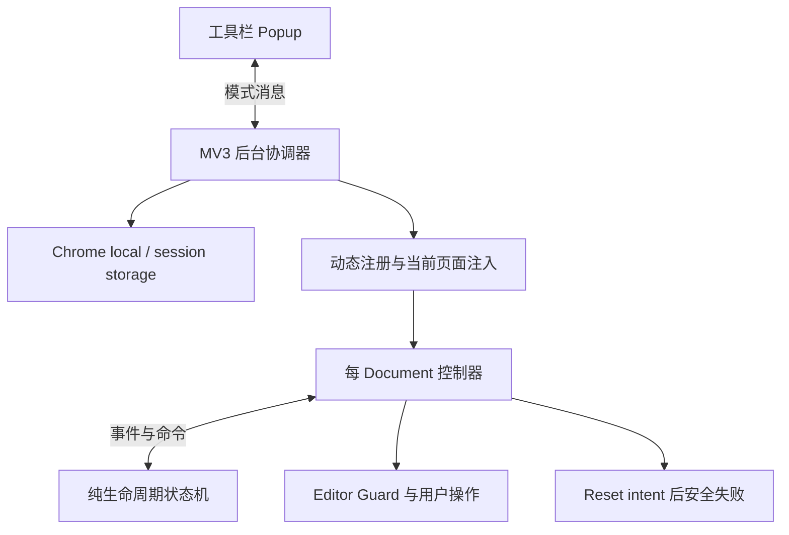

# LeetCode Blind Review：实际架构与面试材料

日期：2026-10-29  
对应仓库阶段：Ticket 01、Ticket 03，以及 PR #22 的审查修复。  
本文中的“项目实现”只描述仓库可核对的业务代码；个人贡献请按自己的真实参与情况表述。

## 先明确项目能做什么

这是一个本地运行的 Chrome Manifest V3 扩展，用于在进入受支持的 LeetCode 中国站练习页面时保护旧草稿，并给用户五秒时间选择保留草稿。保留后解除保护；选择立即 intent 或倒计时结束后，由于生产 Reset 执行器尚未实现，进入 Guarded Failure。

当前实际支持的是动态注册中 `/problems/*/description/*` 所匹配的 Document，以及确定性 fixture 中的语义工作区。真实站点的正式 selector contract 仍待取证。可以讲清楚已经实现的状态机、取消和权限边界；不能把整份设计规格当作完成清单。

## 当前代码架构

| 文件 | 项目实现的职责 | 平台或工具提供的能力 |
| --- | --- | --- |
| `src/background/index.ts` | 开关事务、命令串行队列、动态注册一致性检查、当前活动页保护、清理与回滚、启动 reconciliation、前台资格查询 | Chrome Service Worker、scripting、tabs、windows、storage、runtime messaging |
| `src/content/controller.ts` | Guard 构建、工作区识别、计时、键盘/焦点隔离、事件翻译、取消、样式恢复；本次增加布局保护和清理 ACK | 浏览器 DOM、AbortController、performance、timer、requestAnimationFrame |
| `src/lifecycle/index.ts` | 带类型的状态、事件、命令和纯转移函数；阶段限制、operationId/ref 检查、一次性授权、Bypass 终态 | TypeScript 类型系统；没有引入状态机运行时框架 |
| `src/config/persistent-configuration.ts` | 配置键、schema、默认关闭和五秒默认值 | Chrome storage 保存数据；本次在读取侧增加运行时校验 |
| `src/popup/index.ts` | 用户开关、状态显示、通信错误恢复与重试 | 扩展 popup 容器、HTML 按钮及 runtime messaging |
| `extension/*` | Manifest 最小权限、首帧 CSS、Guard 样式和 Popup 静态页面 | MV3 加载与 document_start 时序 |
| `scripts/build.mjs` | 明确的发布文件集合、清理构建目录、三个入口的构建配置 | esbuild 负责打包与 TypeScript 转换；tsc 单独负责类型检查 |
| `tests/*` | fixture、Chrome harness、生命周期事件测试、发布包审计和回归场景 | Vitest 运行断言；Puppeteer/CDP 驱动真实 Chrome |

本项目没有后端服务、数据库、容器编排或 Kubernetes operator。云原生面试的相关价值来自状态协调、异步竞争、幂等、失败恢复、权限控制和可验证性。

## 最值得讲清楚的业务逻辑

### 1. 开启模式是一段可恢复流程

后台串行执行开关命令。开启时写入 enabling，安装或校正动态内容脚本，在当前合格页面注入 Guard 并要求 ready 应答，最后持久化 on。失败时进入收尾流程。启动时将持久配置与实际注册状态 reconciliation，中间态走清理。

这是多个 Chrome API 调用组成的应用层事务，没有数据库事务的全局原子性。enabling/disabling 是让中断可被识别的记录，补偿清理是恢复手段。本次修复让一次 API 失败不再跳过剩余清理，且只有确认完成后才发布 off。

### 2. 首帧保护与控制器保护分工

动态注册的 CSS 使用全视口伪元素保护尚未完成初始化的 Document。控制器构建可交互的 Guard 后设置 mounted 标记接替它。找到唯一工作区才缩小 Guard；零个或多个候选保持全视口并安全失败。

工作区范围覆盖语言、编辑器、测试、结果、Console、Run/Submit。当前 selector 是 fixture 的 `role="region"` 与 `aria-label="Coding workspace"`，不是已确认的真实 LeetCode contract。本次布局修复增加工作区透明保护、Guard 几何维护和原始样式恢复。

### 3. 状态转移与副作用执行分离

`transitionLifecycle(state, event)` 返回新状态和命令，不直接访问 DOM、计时器或 Chrome API。控制器上报事件、保存状态，再执行对应命令。

例如，只有收到 `workspace-guard-established`，状态才从 establishing-workspace-guard 进入 countdown，并生成恰好五秒后的 deadline。这样纯生命周期测试可以覆盖边界时刻和重复事件，Chrome 测试再证明 DOM 和平台执行结果。

需要诚实说明：生产后台的开关事务目前是独立的异步实现，没有直接调用 reducer 执行全部后台流程。控制器用 reducer 管理 Attempt，并在创建时构造 enabled 的初态。两处存在重复的模式语义，因此需要同时保留真实 Chrome 回归；不能宣称已经实现单一的、覆盖所有上下文的权威状态机。

### 4. 一份授权只转移一次

前台 Guarded Preflight 获得 available Authorization；countdown 接受第一次 button、Enter 或到期事件后，转为 transferred 并只生成一个 reset-sequence intent。后续相同事件不再满足 countdown 前提。

Attempt Bypass 则将授权置为 revoked，生成取消和移除 Guard 命令，并进入不能被普通事件重新激活的 Bypassed Entry。这里保证的是本生命周期内“最多一个 intent”，不是已经实现了真实 Reset 的 exactly-once。

### 5. 状态限制、Ref 和 Abort 一起防迟到副作用

状态转移检查 Document ID、generation、当前 phase；控制器回调还检查 active、acceptingWorkflow 和 AbortSignal。Bypass、Failure、关闭时取消 Attempt timer 和监听器。关闭还移除 runtime listener；Bypass 后保留必要的控制器标记和关闭消息接收，以防重复注入复活同一 entry。

当前 generation 在每个控制器创建时固定为 1，Document ID 是新 UUID。跨 SPA/语言变化递增 generation 的流程尚未实现。可以讲清楚已有检查，不能说快速 A→B→A 导航已受完整保护。

### 6. 错误路径本身是产品行为

定位不唯一或 Reset executor 不可用时，流程停止并保留 Guard。关闭时先停止新工作，再尝试全部收尾。清理失败通过状态与可重试 UI 暴露，而不是把异常吞掉后假装 off。Guard 在失败时仍需维护视觉保护；这与 Attempt 的自动重置任务已经取消是两个不同的资源生命周期。

### 7. Content-Blind 是主动限制能力

代码不读取、复制、散列、记录或上传解题内容；不调用私有 API，不直接写站点草稿或编辑器 model。生产包没有自定义网络客户端和 Reset 点击路径。持久存储只定义配置，会话存储的真实 Attempt/Ownership 协议还没有落地。

Content-Blind 的代价是将来只能确认可见 Reset UI 流程的完成证据，不能逐字证明编辑器等于某份默认模板。当前连 Reset Confirmation adapter 也还未实现。

## 面试介绍示例

### 约 30 秒

“这个项目是 Chrome MV3 的 LeetCode 盲复习扩展，重点是旧草稿的视觉保护和自动流程的安全边界。当前完成了默认关闭、动态注册、工作区 Guard、五秒保留窗口，以及带一次性授权的生命周期状态机。我把状态转移和副作用执行分开，用纯事件测试验证重复和迟到事件，再用真实 Chrome 加载发布包验证。生产 Reset 门禁还没有打开，真实站点适配和跨标签所有权属于后续阶段。”

### 继续展开时可以说什么

优先解释一次完整路径：Popup 请求开启；后台进入 enabling、注册并要求页面 Guard ready；控制器先全视口保护，再根据唯一工作区缩小；Guard 确认后才开始五秒窗口；用户 Bypass 会撤销授权并清理；倒计时或 Enter 只转移一份 intent，目前会进入 Guarded Failure。最后讲一次实际审查发现：只监听 resize/scroll 不足以处理分栏变化，以及只按当前 URL 清理会漏掉同 Document 导航后的控制器。用真实发布包回归复现，再验证修复。

## 云原生开发面试最可能追问的问题

| 优先级 | 问题 | 依据或切入点 |
| --- | --- | --- |
| 1 | JavaScript 单线程，为什么还会有竞态？ | 后台队列和多个 await 边界 |
| 2 | 开关事务中间崩溃怎么办？ | enabling/disabling 与 reconciliation |
| 3 | 如何防止重复事件触发两次副作用？ | phase、Authorization、Bypassed Entry |
| 4 | Abort 和 generation 分别解决什么？ | 控制器与纯状态机的双重检查 |
| 5 | 为什么不能只做单元测试？ | 实际发布包、document_start、Chrome 消息与首帧 |
| 6 | worker 休眠后哪些状态能恢复？ | local 配置与尚未实现的 session 协调 |
| 7 | 多标签页的互斥能靠这条 Promise 队列吗？ | 当前队列的作用域与未来 Ownership 协议 |
| 8 | 如何判断重置成功，又不读代码？ | UI workflow evidence 的设计与当前门禁 |
| 9 | 关闭流程发生错误时为什么不能直接返回 off？ | 实际副作用可能仍然存在 |
| 10 | 如何做到幂等？与 exactly-once 有什么区别？ | 重复注销/中和、终态 latch、单次 intent |
| 11 | 为什么选择 MV3 扩展？哪些是自己实现的？ | Chrome 生命周期能力与业务状态机的区别 |
| 12 | 这个项目有哪些明确没做完的地方？ | ticket 状态、真实 contract、Ownership、Recovery |

### 1. 单线程为什么仍有竞态？

因为异步操作会在 await 处交出执行权。两个请求可以交错读取同一旧状态，再各自写入，或者一个关闭流程已开始，另一个旧回调稍后继续执行。`modeMutationQueue` 把模式修改串行化；状态机和取消条件再限制控制器回调。单线程只避免某一段同步代码同时执行，不替你保证跨 await 的业务操作原子。

追问“能直接换成 Go mutex 吗”：Go 中 mutex 解决共享内存并发访问；这里用 Promise 链表达同一 worker 的异步排队。两者都需要定义临界区，但不能用这个队列去宣称跨进程或跨 worker 的分布式互斥。

### 2. 开启到一半 worker 停了怎么办？

配置记录 off/enabling/on/disabling，启动时检查注册状态。on 的配置尝试恢复正确注册，中间态走清理到 off。它是应用层恢复协议，多次 API 调用之间仍可能被中断。后续 Attempt 与 Ownership 的会话恢复不能只依靠 worker 内存，当前还没实现。

与 Kubernetes 的联系是“观察当前状态、比较目标状态、执行受约束操作”的 reconciliation 思想。不要说本项目使用了 controller-runtime 或已经实现了 Kubernetes controller。

### 3. 为什么重复 Enter 和 timer 不会重复授权？

第一个有效事件把 phase 从 countdown 改成 reset-sequence-intent，同时 Authorization 从 available 转成 transferred。第二个事件再来时，phase 条件不满足，因此没有新命令。Bypass 则进入不可由自动事件离开的终态。当前可证明的是最多一个 intent；真实点击的授权消费与 Commit Barrier 要等执行器实现。

### 4. 已经 Abort，为什么还要检查 Ref？

AbortController 适用于遵守 signal 的监听器或异步操作，但已经进入队列的 Promise continuation、外部消息和普通回调不一定会自动消失。Ref 和当前状态检查使旧结果失去权限，Abort 则尽可能停止资源。当前检查已存在，跨 SPA 的 generation 管理仍在后续票据。

### 5. 测试为什么要加载实际打包扩展？

模块测试不能证明 Manifest 权限、打包文件是否缺失、document_start 注入、Service Worker 与内容脚本消息、真实焦点行为或 CSS 首帧是否正确。fixture 把站点变化变成可控制变量，真实 Chrome 保留平台行为；纯状态机则补足精确时钟和事件竞争。artifact 审计另外检查发布包边界，但正则扫描不能替代行为测试和源码阅读。

### 6. Service Worker 挂掉后互斥还在吗？

目前没有完整的 Attempt Ownership，不能回答“已经保证”。当前可恢复的是持久的模式配置和动态注册一致性，队列只在当前 worker 内存中。设计中的 session 状态、epoch、Document identity、pause ACK 和重新验证，需要按后续 tickets 实现并验证。

### 7. 怎么设计跨标签页接管？

可以讨论现有 ADR 的方案：后台按问题与语言仲裁，记录 Document/generation/epoch；新标签先保留 Guard，旧 owner 先暂停并返回匹配确认，然后才授予新 owner；旧 owner 无响应时不能仅凭超时认定安全。请明确这是设计方案，当前源码没有该协议。

### 8. 不读取代码，怎么证明重置成功？

将来只能依据经过取证和版本化的 UI contract，确认这一次交互在 Commit 后产生了与当前授权关联的完成证据。不能凭任意 toast 或关闭对话框就解锁，也不能声称逐字模板校验。当前 executor 与 Confirmation 都未实现，所以代码直接安全失败。

### 9. 清理失败为什么不一律 catch 后 off？

异常发生不代表副作用不存在。注销失败时后续页面仍可能注入；控制器消息失败时现有任务可能没停止。因此要继续尝试独立清理、保留失败状态并允许重试，确认完再发布 off。这和云服务里不能把补偿请求发送成功当成资源删除成功一样，需要检查结果边界。

### 10. 幂等与 exactly-once 有什么区别？

重复中和已经停止的控制器、移除不存在的样式，目标结果应一致，这是幂等。一次性 Authorization 和终态检查限制同一生命周期最多发出一个 intent，这是 at-most-once 的局部性质。只有增加真正的外部副作用执行、交互身份和完成证据之后，才能讨论更强保证，不能把重试或去重包装成端到端 exactly-once。

### 11. 最小权限限制了什么？

Manifest 申请 storage、scripting 和 LeetCode 中国站问题路径的 host 声明，没有 broad tabs、cookies、webRequest 或远程代码。业务代码还主动不读取内容。权限边界和业务约束共同缩小能力；宿主匹配、内容脚本注入范围与实际 API 可见性需要分别理解，不能说一个 pathname 声明就构成了所有 API 的路径级隔离。

### 12. 你会怎样安排下一步？

先完成 Ticket 02 的真实登录态 contract 证据，再推进 route/entry、SPA generation、语言与前台预算，然后建立 Ownership/Transfer/Recovery。确认这些安全前提后才接 Reset adapter 与执行器。当前 44 个用例规模的回归并不代表完整 V1 发布门禁已经达标。

## 面试前自查

- 能从 Popup 一直讲到一个具体 lifecycle 命令，再定位到执行副作用的控制器代码。
- 能解释模式队列、one-use Authorization、Ref 和 Abort 各自的作用域。
- 能指出当前 generation 固定、Ownership 未实现、Reset executor 未实现，而不是照着设计图扩大完成范围。
- 能讲出至少一个真实失败与修复：布局覆盖、导航后的关闭范围或 API 异常收尾。
- 能清楚区分项目的业务代码、Chrome 提供的能力、esbuild 打包、Vitest/Puppeteer 测试工具，以及本人真实承担的工作。

详细问题、复现证据和保留缺口见：[审查与修复记录](2026-10-29-code-review.md)。
